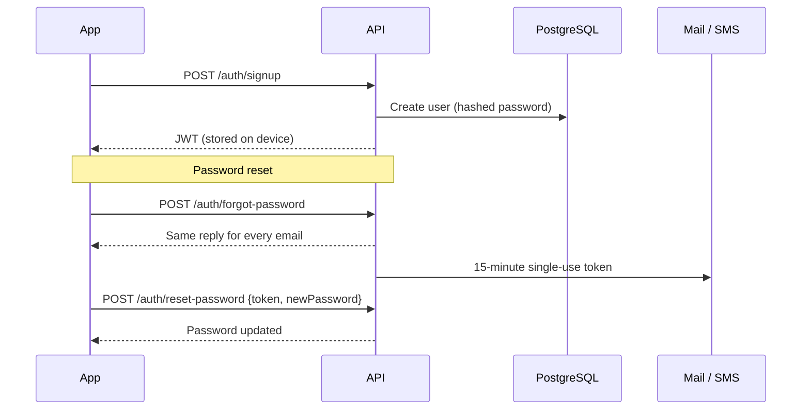
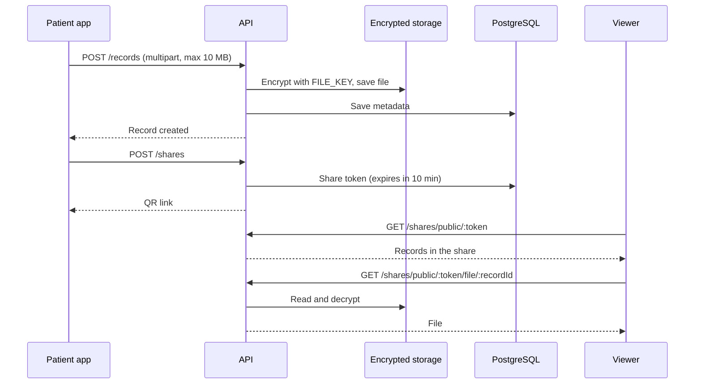
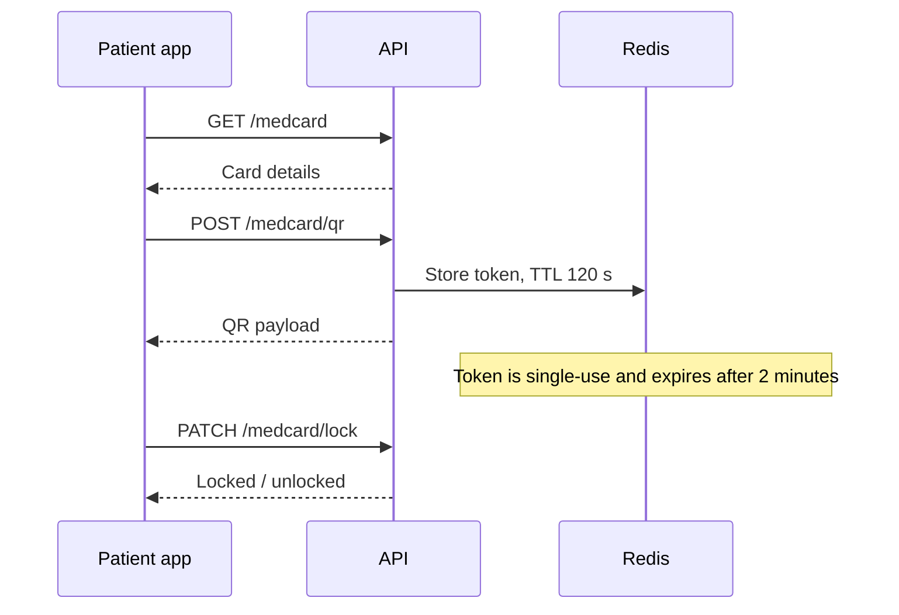
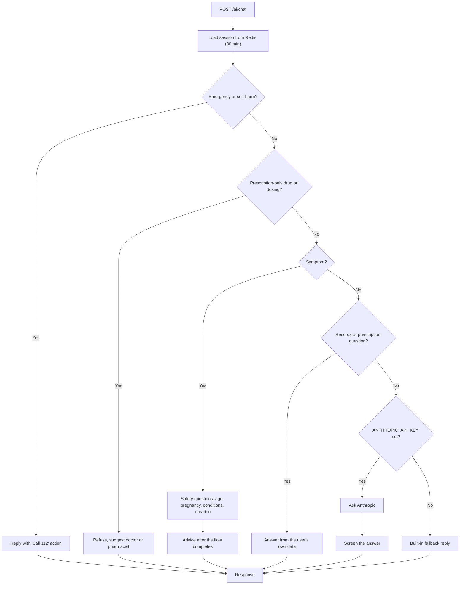
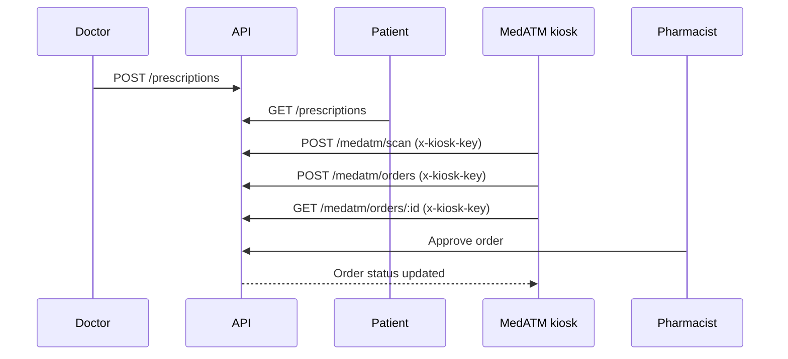

# SARVAYUH

**A secure health app: medical records, digital MedCard, prescriptions, pharmacy kiosk (MedATM) and a safety-first AI assistant.**


---

## Contents

1. [Overview](#overview)
2. [Features](#features)
3. [Architecture](#architecture)
4. [Workflows](#workflows)
5. [Project structure](#project-structure)
6. [Quick start](#quick-start-windows--powershell)
7. [Configuration](#configuration)
8. [API reference](#api-reference)
9. [Testing the app end to end](#testing-the-app-end-to-end)
10. [Security](#security)
11. [Troubleshooting](#troubleshooting)
12. [Development](#development)

---

## Overview

SARVAYUH is an **Expo / React Native** mobile app with a **Node.js / Express** API, **PostgreSQL** and **Redis**.

| Role | What they do |
|---|---|
| **Patient** | Stores encrypted records, shares them by QR, carries a digital MedCard, chats with the AI assistant |
| **Doctor** | Issues prescriptions, views records a patient has shared |
| **Pharmacist** | Approves orders placed at MedATM kiosks |

---

## Features

| Feature | Details |
|---|---|
| **Authentication** | Signup / login with JWT, role-based access, forgot and reset password |
| **Profile** | Patient profile with encrypted profile photo |
| **Health records** | Upload PDF / JPG / PNG (max 10 MB), encrypted at rest, download, delete, export as JSON / CSV / text |
| **Secure sharing** | 10-minute QR link; anyone with it can view and download, no login needed |
| **MedCard** | Digital card with a 2-minute single-use QR, can be locked and unlocked |
| **Prescriptions** | Created by doctors, visible to the patient |
| **MedATM** | Kiosk scan and orders, approved by a pharmacist |
| **AI assistant** | Emergency and self-harm detection, symptom safety flow, refuses prescription-drug and dosing questions, optional Anthropic answers that are screened before display |
| **Feedback** | 1-5 star feedback, queued on the device when offline |
| **Notifications** | Background worker for queued jobs |

---

## Architecture

```
 ┌───────────────────────┐                      ┌─────────────────────────────────────┐
 │      Mobile app       │   HTTPS + Bearer JWT │            API GATEWAY              │
 │ Expo / React Native   │ ───────────────────► │  Express                            │
 │                       │                      │  Middleware: JWT · roles · audit    │
 │  app/      screens    │                      │                                     │
 │  lib/api.ts  client   │                      │  Modules                            │
 └───────────────────────┘                      │   auth · profile · records          │
                                                │   sharing-consent · medcard         │
 ┌───────────────────────┐   x-kiosk-key header │   prescriptions · pharmacy-medatm   │
 │    MedATM kiosk       │ ───────────────────► │   ai-service · feedback             │
 └───────────────────────┘                      └───────┬──────────┬──────────┬───────┘
                                                        │          │          │
                              ┌─────────────────────────┘          │          └──────────────────────┐
                              ▼                                    ▼                                 ▼
                    ┌───────────────────┐              ┌───────────────────┐              ┌────────────────────┐
                    │  PostgreSQL 16    │              │     Redis 7       │              │ Encrypted storage  │
                    │  users, records,  │              │  AI sessions,     │              │ records + photos   │
                    │  shares, orders   │              │  MedCard QR TTL,  │              │ (key: FILE_KEY)    │
                    └───────────────────┘              │  queue            │              └────────────────────┘
                                                       └─────────┬─────────┘
                                                                 ▼
                                                       ┌───────────────────┐        ┌──────────────────────┐
                                                       │  Worker           │        │ Anthropic API        │
                                                       │  npm run worker   │        │ optional, AI answers │
                                                       └───────────────────┘        └──────────────────────┘
```

### Request lifecycle

```
Request
   │
   ├── Public route ───────────────────────────────────┐
   ├── Kiosk route  ── valid x-kiosk-key? ── no → 401   │
   └── Auth route   ── valid JWT?        ── no → 401    │
                          │ yes                         │
                          ▼                             │
                  role allowed? ── no → 403             │
                          │ yes                         │
                          ▼                             ▼
                      Handler  ──►  Audit log  ──►  PostgreSQL / Redis / Files  ──►  Response
```

---

## Workflows

### 1. App journey

```
First time:   /onboarding → /terms → /signup → /profile-setup → /home
Returning:    /login → /home
Forgot pass:  /login → /forgot → /reset-password → /login

From /home:   /records   /medcard   /ai   /profile   Feedback
Sign out (from /profile) clears the token and returns to /login
```

### 2. Authentication and password reset



### 3. Records: upload and QR share



### 4. MedCard QR



### 5. AI assistant decision flow

Checks run in this order. The first match decides the reply.



Response shape: `{ sessionId, messages[], quickReplies[], actions[], flags, disclaimer }`

### 6. Prescription and MedATM



### 7. Feedback

```
Submit feedback → API reachable? ── yes → POST /feedback
                                 └─ no  → queue on device → retry later
```

---

## Project structure

```
sarvayuh-mobile/
├── app/                      # Expo Router screens
├── lib/api.ts                # API client -> backend (JWT auth)
└── backend/
    ├── api-gateway/          # Express server + middleware (JWT, roles, kiosk key, audit)
    ├── infrastructure/       # postgresql, redis, queue, encrypted-storage, docker-compose.yml
    ├── modules/              # auth, profile, records, sharing-consent, medcard,
    │                         # prescriptions, pharmacy-medatm, ai-service, feedback
    ├── sarvayuh-chatbot.ts   # AI chatbot (TypeScript, compiled to dist/)
    ├── tsconfig.json         # backend TypeScript build
    ├── Dockerfile
    ├── .env.example
    └── package.json
```

---

## Quick start (Windows / PowerShell)

**Prerequisites:** Node.js (LTS), Docker Desktop (running), and Expo Go or an emulator / simulator.

### 1. Start the backend

From the project root:

```powershell
cd backend
Copy-Item .env.example .env
```

Open `backend/.env` and set `FILE_KEY` to a 64-character hexadecimal value. Generate one:

```powershell
node -e "console.log(require('crypto').randomBytes(32).toString('hex'))"
```

Start the API, PostgreSQL and Redis:

```powershell
npm install
npm run infra
```

Check `http://localhost:4000/health`. It should return `{"ok":true}`.

> **Important:** `npm run infra` runs the API in Docker. Do not also run `npm run dev`.

### 2. Start the frontend

In a second terminal at the project root (the folder with the root `package.json`):

```powershell
npm install
npx expo start
```

Open the app in a browser or Android emulator from the Expo terminal, or scan the QR code with Expo Go.

| Where the app runs | API URL |
|---|---|
| Android emulator | `http://10.0.2.2:4000` |
| Web / iOS simulator | `http://localhost:4000` |
| Physical phone (Expo Go) | set `EXPO_PUBLIC_API_URL` |

For a physical phone, the phone and computer must be on the same network. In the same PowerShell window, before starting Expo (replace the example IP):

```powershell
$env:EXPO_PUBLIC_API_URL = "http://192.168.1.25:4000"
npx expo start
```

`EXPO_PUBLIC_API_URL` overrides the platform default and is read by `lib/api.ts`.

### 3. Stop the backend

From the `backend` folder (database data is kept):

```powershell
docker compose -f infrastructure/docker-compose.yml down
```

Start again with `npm run infra`.

> **Warning:** do not add `-v` to `down` unless you want to delete the database volume.

### Optional: notification worker

```powershell
npm run worker      # in a separate terminal, inside backend
```

### Optional: run the API without Docker

Start PostgreSQL 16 and Redis 7 locally, set their URLs in `backend/.env`, then run `npm run dev` from `backend`. Do not run it alongside the Docker API.

---

## Configuration

Copy `backend/.env.example` to `backend/.env`. Never commit `.env` (`.env*.local` is gitignored).

| Variable | Purpose |
|---|---|
| `FILE_KEY` | 64-character hex key that encrypts uploaded files at rest |
| `DEV_RESET_TOKEN` | `true` returns the reset token in the response so the flow can be tested without email. **Set `false` in production.** |
| `ANTHROPIC_API_KEY` | Optional. Enables AI answers to free-form questions |
| `EXPO_PUBLIC_API_URL` | Frontend only. Overrides the API base URL |

Database and Redis URLs are also set in `backend/.env.example`.

---

## API reference

Roles: `patient`, `doctor`, `pharmacist`. Kiosk (MedATM) routes use the `x-kiosk-key` header. `GET /health` returns `{ "ok": true }`.

| Method | Path | Who |
|---|---|---|
| POST | `/auth/signup`, `/auth/login` | public |
| POST | `/auth/forgot-password` | public (always replies the same, no user probing) |
| POST | `/auth/reset-password` | public (15 min single-use token) |
| GET / PUT | `/profile` | any / patient |
| POST | `/profile/photo` | patient (multipart, JPG/PNG/WEBP, max 5 MB, encrypted at rest) |
| GET | `/profile/photo` | any (streams your own avatar) |
| GET / POST | `/records` | patient; `GET ?patientId=` for shared records |
| GET | `/records/:id/file` | owner / active share |
| DELETE | `/records/:id` | owner (also removes the encrypted file) |
| POST / GET / DELETE | `/shares` | patient |
| GET | `/shares/public/:token` | public (QR share link, no login, expires) |
| GET | `/shares/public/:token/file/:recordId` | public (file behind a share link) |
| GET | `/medcard` | patient |
| POST | `/medcard/qr` | patient (2 min, single-use) |
| PATCH | `/medcard/lock` | patient |
| POST / GET | `/prescriptions` | doctor / patient |
| POST | `/medatm/scan`, `/medatm/orders` | kiosk |
| GET | `/medatm/orders/:id` | kiosk |
| GET / POST | `/medatm/orders`, `/orders/:id/approve` | pharmacist |
| POST | `/ai/chat` | patient (safety checks, symptom flow, record / prescription answers) |
| GET | `/ai/init` | patient (greeting, quick replies, disclaimer) |
| POST | `/feedback` | any (1-5 stars) |
| GET | `/feedback` | any (your own feedback) |

---

## Testing the app end to end

1. **Backend up:** `npm run infra` (Docker) or `npm run dev` (local).
2. **Onboarding:** `/onboarding` → `/terms` → `/signup` (`POST /auth/signup`, JWT stored) → `/profile-setup` (`PUT /profile`, optional `POST /profile/photo`) → `/home`.
3. **Records** (`/records`): list (`GET /records`), upload PDF / JPG / PNG (`POST /records`, multipart, max 10 MB, encrypted at rest), download, delete (`DELETE /records/:id`), export JSON / CSV / text, share via QR (10-minute `POST /shares` link that anyone can scan and download from).
4. **MedCard** (`/medcard`): `GET /medcard`, issue a 2-minute single-use QR (`POST /medcard/qr`, Redis TTL), lock / unlock (`PATCH /medcard/lock`).
5. **AI assistant** (`/ai`): `GET /ai/init` returns the greeting and quick replies; `POST /ai/chat` takes `{ sessionId?, message }`.
   - Emergency and self-harm messages are caught first and answer with a "Call 112" action.
   - Prescription-only drugs and dosing questions are refused.
   - A symptom opens a short safety flow (age, pregnancy, conditions, duration) before any advice.
   - Session state lives in Redis (30 min), so the flow survives restarts.
   - Free-form questions go to Anthropic only when `ANTHROPIC_API_KEY` is set, and the answer is screened before it is shown.
6. **Profile** (`/profile`): `GET /profile`. Sign out clears the token and goes to `/login`.
7. **Password reset:** `/login` → "Forgot password?" → `/forgot` → `/reset-password`.
8. **Feedback** (on Home): `POST /feedback`. If the API is unreachable, the entry is queued on the device.

---

## Security

- JWT authentication with role checks on protected routes, plus audit middleware in the gateway.
- Uploaded files and profile photos are encrypted at rest with `FILE_KEY`.
- Share links expire after 10 minutes. MedCard QR codes expire after 2 minutes and are single-use.
- Password reset tokens are single-use and valid for 15 minutes. The forgot-password reply is the same for every email.
- Kiosk routes require the `x-kiosk-key` header.
- Keep `DEV_RESET_TOKEN=false` in production.
- The AI assistant is informational only, always shows a disclaimer, and routes emergencies to 112.

---

## Troubleshooting

**"The development server returned response error code: 500" / "Failed to download remote update"**
Metro cached a stale module resolution, usually after `npm install` or `npx expo install --fix` swapped `node_modules` while the dev server was running. Restart with a cleared cache. A plain restart is not enough.

```powershell
npx expo start --clear
```

**"Unable to resolve module expo-modules-core"**
Same cause. If `expo-modules-core` is present in `node_modules`, clear the cache instead of reinstalling.

**API calls fail on Android**
The app uses `http://10.0.2.2:4000` on an emulator and `http://localhost:4000` elsewhere. On a physical device set `EXPO_PUBLIC_API_URL=http://<your-LAN-IP>:4000` before starting Expo.

**`/health` does not respond**
Make sure Docker Desktop is running, then check the logs:

```powershell
docker compose -f infrastructure/docker-compose.yml logs -f api
```

---

## Development

### Docker commands

```bash
cd backend
docker compose -f infrastructure/docker-compose.yml up -d      # postgres + redis + api
docker compose -f infrastructure/docker-compose.yml logs -f api
docker compose -f infrastructure/docker-compose.yml down
```

The `api` container uses `backend/Dockerfile`, depends on healthy postgres / redis, and runs migrations on startup.

### Code quality

```powershell
npx tsc --noEmit                      # app type check (must be clean)
npx eslint .                          # lint (0 errors; `npx expo lint` also works)
npm run typecheck --prefix backend    # backend type check
npm run build --prefix backend        # compile backend/sarvayuh-chatbot.ts -> backend/dist/
```

The backend chatbot is TypeScript and is compiled to `backend/dist/` by `npm run build`. `npm start` and `npm run dev` build it first, and the Docker image builds it in a separate stage so TypeScript never ships in the runtime image. `backend/dist/` is gitignored.

`eslint.config.js` extends `eslint-config-expo` and adds Node.js globals for `backend/**/*.js`. The React Compiler rules (`react-hooks/refs`, `react-hooks/purity`, `react-hooks/set-state-in-effect`) are warnings here: the compiler is not enabled in this project, and they flag standard React Native idioms such as `Animated.Value` refs, `PanResponder` gestures and mount-time data fetching.

### More details

- `backend/README.md`: folder structure, endpoint flow, remaining work.
- Secrets: `backend/.env.example` → `backend/.env`.
