<div align="center">

# 🩺 SARVAYUH

### *Your health records, MedCard, prescriptions, pharmacy kiosk and AI health assistant, all in one app.*

<br/>


<br/>

[✨ Features](#-features) •
[🧱 Architecture](#-system-architecture) •
[🔄 Workflows](#-workflows) •
[🚀 Quick Start](#-quick-start-windows--powershell) •
[🔌 API](#-backend-endpoints) •
[🛠 Troubleshooting](#-troubleshooting)

</div>

---

## 📖 About

**SARVAYUH** is an **Expo / React Native** mobile app backed by a **Node.js / Express** API, **PostgreSQL** and **Redis**.

| 🧑‍⚕️ Who | 💡 What they get |
|---|---|
| **Patient** | Encrypted medical records, QR sharing, digital MedCard, AI health assistant |
| **Doctor** | Issue prescriptions, view records a patient has shared |
| **Pharmacist** | Approve orders placed at MedATM kiosks |

---

## ✨ Features

| | Area | What it does |
|---|---|---|
| 🔐 | **Auth** | Signup / login with JWT, role-based access, forgot / reset password |
| 👤 | **Profile** | Patient profile and encrypted profile photo |
| 📁 | **Health records** | Upload PDF / JPG / PNG (max 10 MB), encrypted at rest, download, delete, export (JSON / CSV / text) |
| 🔗 | **Secure sharing** | 10-minute QR share link, anyone can scan and download, no login needed |
| 💳 | **MedCard** | Digital health card with a 2-minute single-use QR, lock / unlock |
| 💊 | **Prescriptions** | Doctors create them, patients view them |
| 🏧 | **MedATM** | Kiosk scan and orders, pharmacist approval |
| 🤖 | **AI chatbot** | Emergency / self-harm detection first, symptom safety flow, drug and dosing refusal, optional Anthropic answers with output screening |
| ⭐ | **Feedback** | 1-5 star app feedback, queued on the device when offline |
| 🔔 | **Notifications** | Background worker for queued jobs |

---

## 🧰 Tech stack

| Layer | Technology |
|---|---|
| 📱 Mobile app | Expo, React Native, Expo Router, TypeScript |
| ⚙️ API | Node.js, Express (api-gateway with middleware) |
| 🗄 Database | PostgreSQL 16 |
| ⚡ Cache / sessions / TTL | Redis 7 |
| 📬 Background jobs | Queue + worker (`npm run worker`) |
| 🔒 File security | Encrypted storage (key from `FILE_KEY`, 64 hex characters) |
| 🧠 AI | Rule-based safety layer in TypeScript, plus optional Anthropic API |
| 🐳 DevOps | Docker, Docker Compose |
| ✅ Quality | TypeScript, ESLint (`eslint-config-expo`) |

---

## 🧱 System architecture

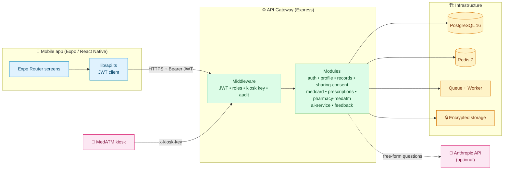

### 🛡 Request lifecycle

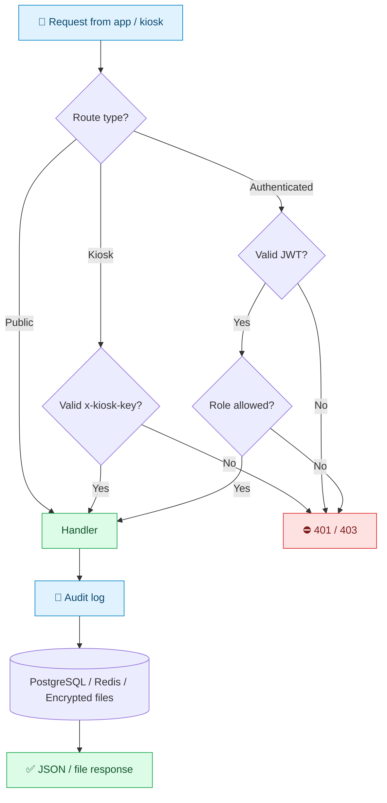

---

## 🗂 Project structure

```
sarvayuh-mobile/
├── 📱 app/                      # Expo Router screens
├── 🔌 lib/api.ts                # API client -> backend (JWT auth)
└── 🖥 backend/
    ├── api-gateway/             # Express server + middleware (JWT, roles, kiosk key, audit)
    ├── infrastructure/          # postgresql, redis, queue, encrypted-storage, docker-compose.yml
    ├── modules/                 # auth, profile, records, sharing-consent, medcard,
    │                            # prescriptions, pharmacy-medatm, ai-service, feedback
    ├── sarvayuh-chatbot.ts      # SARVAYUH AI chatbot (TypeScript, compiled to dist/)
    ├── tsconfig.json            # backend TypeScript build
    ├── Dockerfile
    ├── .env.example
    └── package.json
```

---

## 🔄 Workflows

> 💡 Each workflow shows the **user flow** (what the person does) and the **tech flow** (what happens behind the scenes).

### 🧭 1. App journey

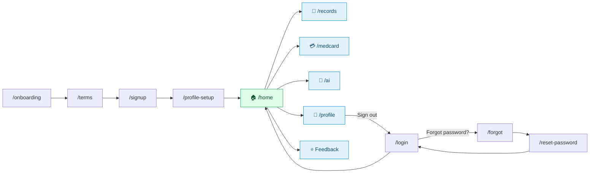

### 🔐 2. Authentication

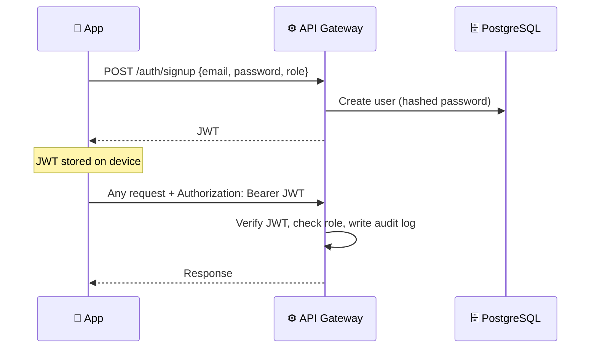

### 🔑 3. Password reset

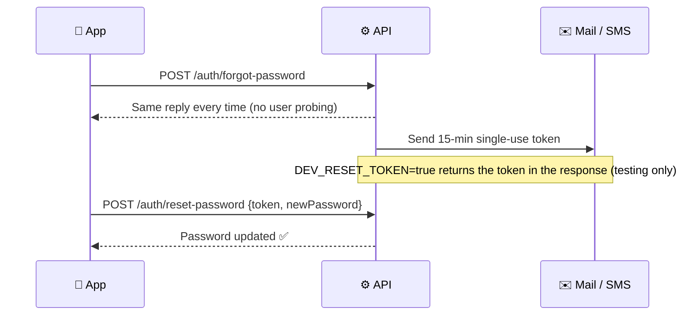

### 📁 4. Records: upload, store, share

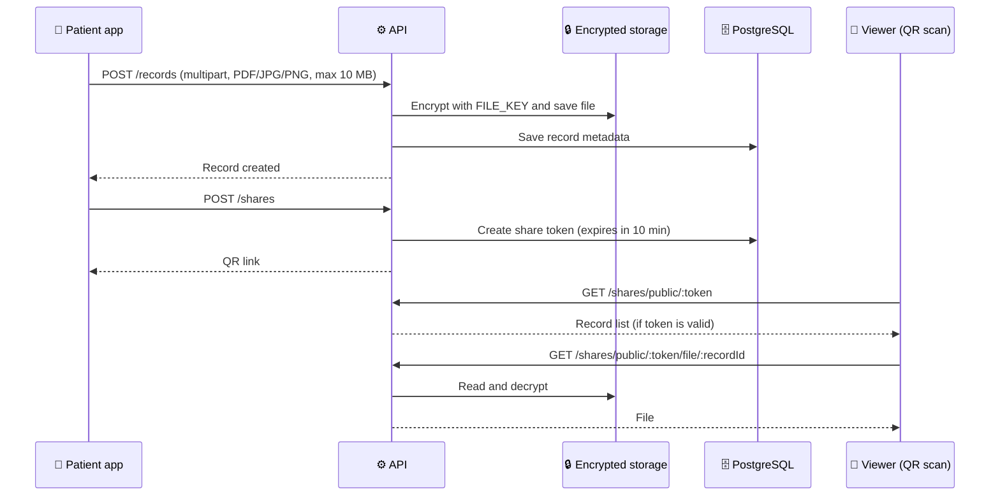

### 💳 5. MedCard QR (single-use)

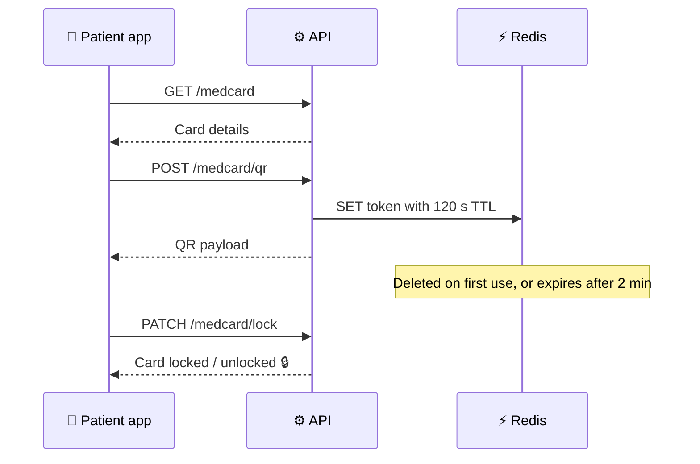

### 🤖 6. AI chatbot decision flow

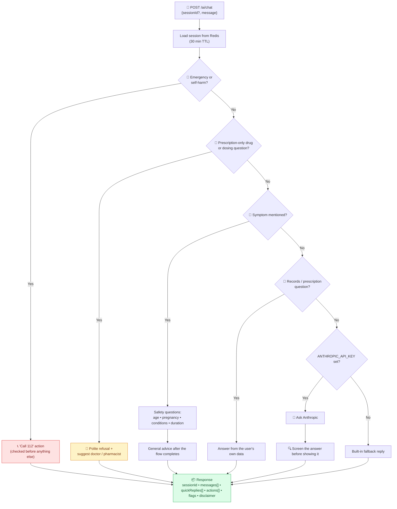

### 💊 7. Prescription and MedATM

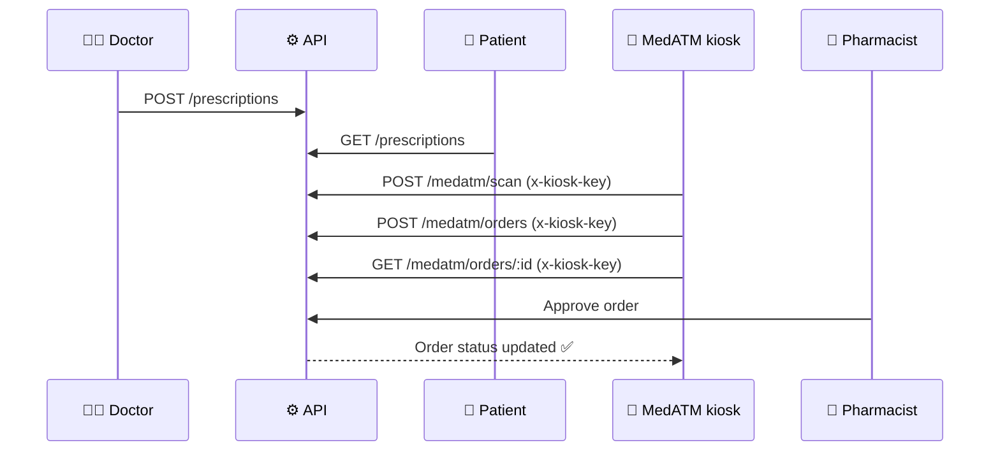

### ⭐ 8. Feedback (offline-safe)

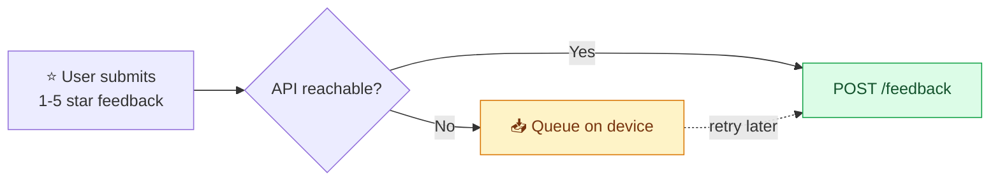

---

## 👥 Roles and access

| Role | Can do |
|---|---|
| 🧑 `patient` | Profile, records, shares, MedCard, own prescriptions, AI chat |
| 🧑‍⚕️ `doctor` | Create prescriptions, view shared records (`GET /records?patientId=`) |
| 💼 `pharmacist` | Approve MedATM orders |
| 🏧 kiosk (not a user) | MedATM routes via the `x-kiosk-key` header |

---

## 🚀 Quick start (Windows / PowerShell)

### ✅ Prerequisites

- Node.js (LTS) and npm
- Docker Desktop (running)
- Expo Go on your phone, or an Android emulator / iOS simulator

### 🖥 1. Start the backend

From the project root:

```powershell
cd backend
Copy-Item .env.example .env
```

Open `backend/.env` and set `FILE_KEY` to a 64-character hexadecimal value. Generate one with:

```powershell
node -e "console.log(require('crypto').randomBytes(32).toString('hex'))"
```

Then start the API, PostgreSQL and Redis:

```powershell
npm install
npm run infra
```

Wait for the Docker services to start, then open `http://localhost:4000/health`. It should return `{"ok":true}`.

> [!IMPORTANT]
> `npm run infra` runs the API **inside Docker**, so do **not** also run `npm run dev`.

### 📱 2. Start the frontend

Open a second terminal in the project root (the folder with the root `package.json`):

```powershell
npm install
npx expo start
```

Open the app in a browser or Android emulator using the Expo terminal options, or scan the QR code with Expo Go.

| Where the app runs | API URL used |
|---|---|
| 🤖 Android emulator | `http://10.0.2.2:4000` |
| 🌐 Web / 🍎 iOS simulator | `http://localhost:4000` |
| 📲 Physical phone (Expo Go) | `EXPO_PUBLIC_API_URL` (see below) |

> [!TIP]
> For a physical phone, the phone and computer must be on the **same network**. Set your computer's LAN IP in the same PowerShell window before starting Expo (replace the example IP):
>
> ```powershell
> $env:EXPO_PUBLIC_API_URL = "http://192.168.1.25:4000"
> npx expo start
> ```
>
> `EXPO_PUBLIC_API_URL` overrides the platform default and is read by `lib/api.ts`.

### 🛑 Stop the backend

From the `backend` folder (keeps database data):

```powershell
docker compose -f infrastructure/docker-compose.yml down
```

Start it again with `npm run infra`.

> [!WARNING]
> Do **not** add `-v` to the `down` command unless you intend to delete the database volume.

### 🗺 Startup flow at a glance

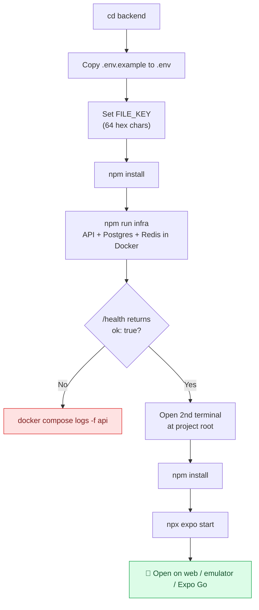

---

## 🧩 Other backend options

**🔔 Notification worker.** In another terminal inside `backend`:

```powershell
npm run worker
```

**🏠 Run the API without Docker.** Start PostgreSQL 16 and Redis 7 locally, set their URLs in `backend/.env`, then run `npm run dev` from `backend`.

> [!NOTE]
> Do not run `npm run dev` alongside the Docker API.

---

## 🔧 Environment variables

Defined in `backend/.env.example`. Never commit `.env` (`.env*.local` is gitignored).

| Variable | Purpose |
|---|---|
| `FILE_KEY` | 64-char hex key used to encrypt uploaded files at rest |
| `DEV_RESET_TOKEN` | `true` returns the reset token in the API response (testing only). **Set `false` in production.** |
| `ANTHROPIC_API_KEY` | Optional. Enables AI answers for free-form questions |
| `EXPO_PUBLIC_API_URL` | Frontend only. Overrides the API base URL (physical devices) |

Database, Redis and other settings: see `backend/.env.example`.

---

## 🔌 Backend endpoints

<details open>
<summary><b>Click to expand / collapse the full API table</b></summary>

<br/>

| Method | Path | Who |
|---|---|---|
| POST | `/auth/signup`, `/auth/login` | 🌍 public |
| POST | `/auth/forgot-password` | 🌍 public (always replies the same, no user probing) |
| POST | `/auth/reset-password` | 🌍 public (15 min single-use token) |
| GET / PUT | `/profile` | any / patient |
| POST | `/profile/photo` | patient (multipart, JPG/PNG/WEBP, max 5 MB, encrypted at rest) |
| GET | `/profile/photo` | any (streams your own avatar) |
| GET / POST | `/records` | patient; `GET ?patientId=` shared records |
| GET | `/records/:id/file` | owner / active share |
| DELETE | `/records/:id` | owner (also removes the encrypted file) |
| POST / GET / DELETE | `/shares` | patient |
| GET | `/shares/public/:token` | 🌍 public (QR share link, no login, expires) |
| GET | `/shares/public/:token/file/:recordId` | 🌍 public (file behind a share link) |
| GET | `/medcard` | patient |
| POST | `/medcard/qr` | patient (2 min, single-use) |
| PATCH | `/medcard/lock` | patient |
| POST / GET | `/prescriptions` | doctor / patient |
| POST | `/medatm/scan`, `/medatm/orders` | 🏧 kiosk (`x-kiosk-key`) |
| GET | `/medatm/orders/:id` | 🏧 kiosk |
| GET / POST | `/medatm/orders`, `/orders/:id/approve` | pharmacist |
| POST | `/ai/chat` | patient (safety checks, symptom flow, record / prescription answers) |
| GET | `/ai/init` | patient (greeting, quick replies, disclaimer) |
| POST | `/feedback` | any (1-5 stars) |
| GET | `/feedback` | any (your own feedback) |
| GET | `/health` | 🌍 public, returns `{ "ok": true }` |

</details>

---

## 🧪 Test flow (end to end)

<details>
<summary><b>Click to expand the 8-step test checklist</b></summary>

<br/>

1. **Backend up** with `npm run infra` (Docker) or `npm run dev` (local).
2. **Onboarding:** `/onboarding` → `/terms` → `/signup` (`POST /auth/signup`, JWT stored) → `/profile-setup` (`PUT /profile`, optional `POST /profile/photo`) → `/home`.
3. **Records** (`/records`): list (`GET /records`), upload PDF / JPG / PNG (`POST /records`, multipart, max 10 MB, encrypted at rest), download, delete (`DELETE /records/:id`), export JSON / CSV / text, and share via QR (a 10-minute `POST /shares` link that anyone can scan and download from).
4. **MedCard** (`/medcard`): `GET /medcard`, issue a 2-minute single-use QR (`POST /medcard/qr`, Redis TTL), lock / unlock (`PATCH /medcard/lock`).
5. **AI chatbot** (`/ai`): `GET /ai/init` gives the greeting and quick replies. `POST /ai/chat` takes `{ sessionId?, message }` and returns `{ sessionId, messages[], quickReplies[], actions[], flags, disclaimer }`.
   - Emergency and self-harm messages are caught first and answer with a "Call 112" action.
   - Prescription-only drugs and dosing questions are refused.
   - A symptom opens a short safety question flow (age, pregnancy, conditions, duration) before any advice.
   - Session state lives in Redis (30 min), so the flow survives restarts.
   - Free-form questions go to Anthropic only when `ANTHROPIC_API_KEY` is set, and the answer is screened before it is shown.
6. **Profile** (`/profile`): `GET /profile`. Sign out clears the token and goes to `/login`.
7. **Password reset:** `/login` → "Forgot password?" → `/forgot` → `/reset-password` (`POST /auth/forgot-password`, then `/auth/reset-password`).
8. **Feedback** (on Home): `POST /feedback`. If the API is unreachable, the entry is queued on the device.

</details>

---

## 🔒 Security notes

- 🔑 JWT auth with role checks on every protected route; audit middleware in the gateway.
- 🗄 Uploaded files and profile photos are **encrypted at rest** with `FILE_KEY`.
- ⏱ Share links expire after **10 minutes**; MedCard QR codes expire after **2 minutes** and are single-use (Redis TTL).
- 🔁 Password reset tokens are **single-use** and valid for **15 minutes**; the forgot-password reply is identical for every email, so accounts cannot be probed.
- 🏧 Kiosk routes require the `x-kiosk-key` header.
- 🚫 Keep `DEV_RESET_TOKEN=false` in production.
- 🩺 The AI chatbot is informational only and shows a medical disclaimer; emergencies always route to **112**.

---

## 🛠 Troubleshooting

<details>
<summary><b>❌ "The development server returned response error code: 500" / "Failed to download remote update"</b></summary>

<br/>

Metro cached a stale module resolution (usually after `npm install` or `npx expo install --fix` swapped `node_modules` while the dev server was running). Restart with a cleared cache:

```powershell
npx expo start --clear
```

A plain restart is not enough, because the bad entry lives in the Metro cache.

</details>

<details>
<summary><b>❌ "Unable to resolve module expo-modules-core"</b></summary>

<br/>

Same cause. If `expo-modules-core` is present in `node_modules`, clear the cache instead of reinstalling.

</details>

<details>
<summary><b>❌ API calls fail on Android</b></summary>

<br/>

The app uses `http://10.0.2.2:4000` on an emulator and `http://localhost:4000` elsewhere. On a physical device set `EXPO_PUBLIC_API_URL=http://<your-LAN-IP>:4000` before starting Expo.

</details>

<details>
<summary><b>❌ <code>/health</code> does not respond</b></summary>

<br/>

Check that Docker Desktop is running, then view the API logs:

```powershell
docker compose -f infrastructure/docker-compose.yml logs -f api
```

</details>

---

## 🐳 Docker commands

```bash
cd backend
docker compose -f infrastructure/docker-compose.yml up -d      # postgres + redis + api
docker compose -f infrastructure/docker-compose.yml logs -f api
docker compose -f infrastructure/docker-compose.yml down
```

The `api` container uses `backend/Dockerfile` and depends on healthy postgres / redis. It runs migrations on startup.

---

## ✅ Code quality

```powershell
npx tsc --noEmit                      # app type check (must be clean)
npx eslint .                          # lint (0 errors; `npx expo lint` also works)
npm run typecheck --prefix backend    # backend type check
npm run build --prefix backend        # compile backend/sarvayuh-chatbot.ts -> backend/dist/
```

The backend chatbot is TypeScript and is compiled to `backend/dist/` by `npm run build` (`npm start` and `npm run dev` build it first; the Docker image builds it in a separate stage so TypeScript never ships in the runtime image). `backend/dist/` is gitignored.

`eslint.config.js` extends `eslint-config-expo` and adds Node.js globals for `backend/**/*.js`. The React Compiler rules (`react-hooks/refs`, `react-hooks/purity`, `react-hooks/set-state-in-effect`) are warnings here: the compiler is not enabled in this project and they flag standard React Native idioms such as `Animated.Value` refs, `PanResponder` gestures and mount-time data fetching.

---

## 📚 More details

- 📄 `backend/README.md`: folder structure, endpoint flow, remaining work.
- 🔐 Secrets: `backend/.env.example` → `backend/.env`.

<div align="center">

<br/>

**Made with ❤️ for better, safer healthcare access**

</div>
